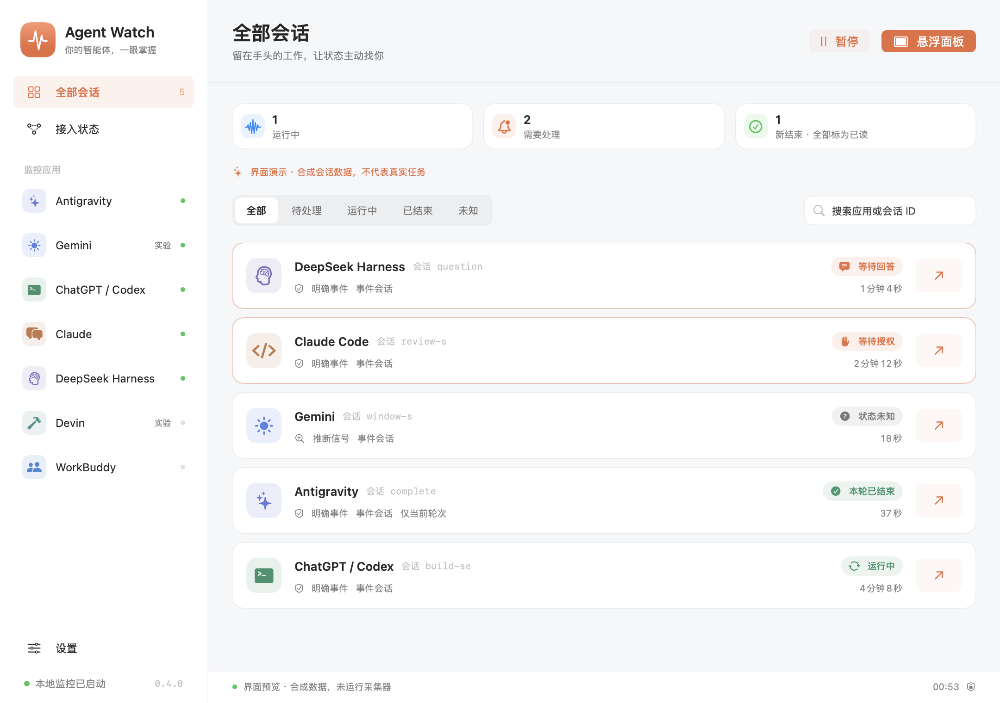
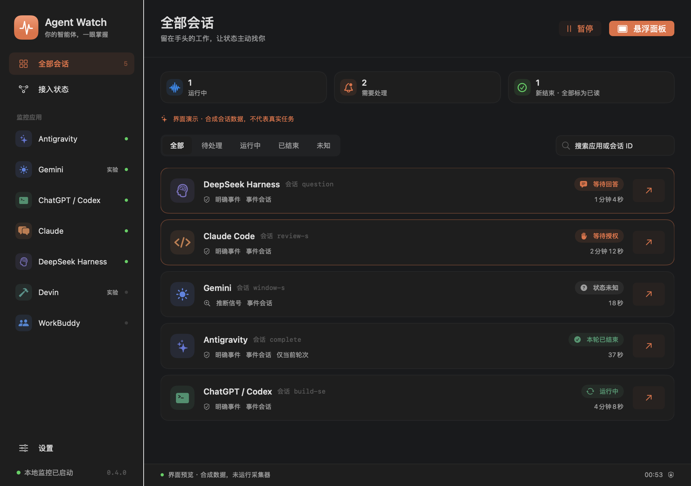

# 界面与视觉来源

0.4.0 的布局参考 [CC Switch 官方界面概览](https://github.com/farion1231/cc-switch/blob/main/docs/user-manual/zh/1-getting-started/1.3-interface.md) 的侧栏、页头、内容卡片与设置入口。未复制其代码、应用标志或图片。Agent Watch 的图标由 `scripts/make-icon.swift` 原创绘制：刘海下方悬挂的状态条，三个圆点分别对应运行、待授权和本轮结束。界面中的各应用图标直接读取本机已安装应用的图标；未安装时退回系统 SF Symbols（San Francisco Symbols，Apple 系统符号）。

主界面包含全部会话、按应用筛选、接入状态和设置。会话可按运行、待处理、结束与未知筛选，并按应用名称或会话标识搜索。等待授权、等待回答和失败优先排序；“本轮已结束”仅描述当前轮次。不同会话显示各自的标识，子任务独立标记。确认过的终态保留为历史记录，过期的进行中状态显示未知。

菜单栏随运行数、待处理数和未读结束数变化。指针停在屏幕刘海或下沿时，横向状态条从刘海下方展开，显示已打开的受支持应用及其近期运行信号。应用图标取自本机，点图标可切回对应应用。无刘海的屏幕可悬停 Agent Watch 菜单栏图标。点击菜单栏图标可查看近期会话和持续时间，也可标记已读。

已打开的应用发出新的等待授权或本轮结束信号时，状态条主动弹出。指针在刘海或状态条内时保持显示，移开约 3 秒后收起。授权提醒会一直显示，直到授权完成或点叉收起；卡片标明是哪个智能体、已等待多久，点按即切换到该应用。点叉也可收起，悬停仍可看到待授权状态。推断信号按相应提醒设置触发。在设置的「诊断与演示」中可点「等待授权」试用授权提醒，也可先点「运行中」再点「本轮已结束」试用完成提醒。

设置支持跟随系统、浅色和深色。外观选择保存在本机；权限请求均由用户点击发起。实验观察和推断提醒默认关闭。

## 开发预览

下面的图片由当前 SwiftUI 视图离屏渲染，使用显式标记的合成会话；不是实际客户端兼容性验收。预览模式不启动采集器，不读取或写入监控历史，不请求权限、不发送通知。

构建后可运行 `AgentWatch --render-previews /absolute/output/directory` 重新生成预览。该参数仅用于开发，输出包括浅色、深色、最小窗口尺寸、悬停状态条、菜单、设置和接入页。
